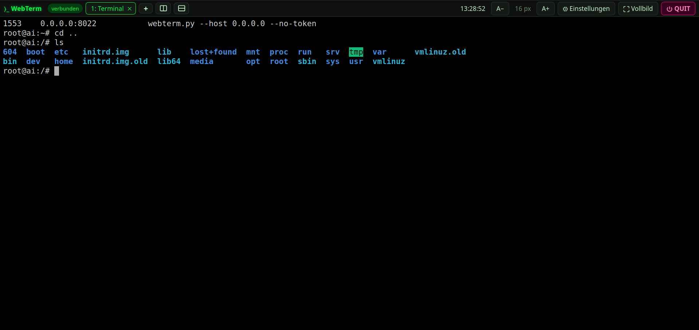

# WebTerm – Linux-Terminal im Browser / Linux terminal in the browser



**[Deutsch](#deutsch)** · **[English](#english)**

---

## Deutsch

WebTerm ist ein vollwertiges Linux-Terminal im Browser. Reines Python 3, **keine
Zusatzpakete nötig**. xterm.js liegt lokal in `static/vendor/`, dadurch funktioniert
WebTerm auch ohne Internet.

### Funktionen

- Mehrere Terminals in **Tabs**, jedes Terminal beliebig **teilbar** (nebeneinander/untereinander)
- **11 Farbschemata**, darunter das neue Standardschema **„Neon Matrix“** (Neongrün/Pink auf
  Schwarz), dazu Solarized, Dracula, Gruvbox, Nord, Retro Grün/Bernstein u. a. – jede
  Farbe einzeln einstellbar
- Schriftgröße, Schriftart, Zeilenhöhe, Cursor-Form, Verlauf; Einstellungen werden im
  Browser gespeichert und lassen sich exportieren/importieren
- **Vollbild** mit Tastatursperre: auch F11, Strg+W usw. gehen ans Terminal
- Funktionstasten, Alt/Strg-Kombinationen und Maus für `mc`, `htop`, `nano`, `vim` …
- 256 Farben / Truecolor, Unicode
- Token-Schutz beim Zugriff aus dem Netzwerk

### Starten

```bash
git clone https://github.com/kamm3330/webterm.git
cd webterm
python3 webterm.py
```
Danach im Browser öffnen: **http://localhost:8022**

| Option | Bedeutung |
|---|---|
| `--port 8022` | Port |
| `--host 0.0.0.0` | Zugriff aus dem Netzwerk erlauben (erzeugt automatisch ein Token, die URL wird angezeigt) |
| `--token GEHEIM` | eigenes Zugangs-Token |
| `--no-token` | kein Token (**nicht empfohlen** bei Netzwerkzugriff) |
| `--shell "/usr/bin/mc"` | anderes Programm statt der Login-Shell starten |

**Autostart mit systemd:** Ordner nach `/opt/webterm` kopieren, dann
```bash
sudo cp webterm.service /etc/systemd/system/
sudo systemctl enable --now webterm
```
In `webterm.service` ggf. `User=` und die Startoptionen anpassen.

### Bedienung

- **⚙ Einstellungen**: Schriftgröße, Schriftart, Zeilenhöhe, Farbschemata, jede Farbe
  einzeln (Hintergrund, Text, Cursor, Markierung, 16 ANSI-Farben), Cursor-Form,
  Verlauf. Alles wird im Browser gespeichert und lässt sich exportieren und importieren.
- **⛶ Vollbild**: Knopf oder `Strg+Umschalt+F`. Im Vollbild blendet sich die Leiste aus;
  wenn die Maus an den oberen Rand fährt, erscheint sie wieder.
- **Geteilte Ansicht**: ◫ = vertikal teilen (nebeneinander, `Strg+Umschalt+E`),
  ⊟ = horizontal teilen (untereinander, `Strg+Umschalt+O`). Mehrfach teilen geht auch.
  Ein Klick in einen Bereich macht ihn aktiv (farbig umrandet).
- `Strg+Umschalt+X`: aktives Terminal schließen (im geteilten Tab nur diesen Bereich)
- `Strg+Umschalt+Bild↑` / `Bild↓`: vorheriges / nächstes Terminal
- **Uhr** oben rechts (Datum als Tooltip)
- **⏻ QUIT**: beendet alle Shells und schließt das Browserfenster. Darf die Seite das
  Fenster nicht schließen, erscheint ein Hinweis – dann mit Strg+W schließen.
- `Strg+Umschalt+C` / `V`: Kopieren / Einfügen
- `Strg+Umschalt+ +` / `−` / `0`: Schriftgröße

### Tastenkürzel von Linux-Programmen (mc, htop, nano, vim …)

F1–F12, Esc, Alt- und Strg-Kombinationen sowie die Maus werden an das Terminal
weitergegeben (getestet: `mc` beendet sich mit F10). Die Browser-Funktionen auf diesen
Tasten (F10-Menüleiste, F5 Neu laden, F3 Suchen …) werden dabei blockiert.

**Einschränkung des Browsers:** Ein paar Tasten fängt der Browser ab, bevor die Seite sie
bekommt: **F11, Strg+W, Strg+T, Strg+N**. Lösung: **Vollbild in Chrome, Chromium oder Edge**.
Dann sperrt WebTerm die Tastatur (Keyboard Lock API) und auch diese Tasten gehen ans
Terminal. Vollbild verlassen: **Esc gedrückt halten**. Das klappt nur über `http://localhost`
oder HTTPS. Firefox unterstützt diese Sperre nicht.

**Pfeiltasten gehen nicht?** In ⚙ Einstellungen „Tastendiagnose“ einschalten. Die Leiste zeigt
dann für jede Taste `key | code | keyCode → Verarbeitung`. Tasten mit keyCode 229
(Bildschirmtastatur, IME, TV-Browser) übersetzt WebTerm selbst.

Als Shell wird die Login-Shell aus `/etc/passwd` gestartet (`bash -l -i`), nicht `$SHELL`.
So gibt es auch beim Start aus cron/systemd Verlauf und Aliase aus `~/.bashrc`.

### Sicherheit

WebTerm ist eine Shell mit den Rechten des startenden Benutzers.
Standardmäßig lauscht es nur auf `127.0.0.1`. Beim Netzwerkzugriff gibt es ein Token
(außer mit `--no-token`), WebSocket-Verbindungen von fremden Webseiten werden abgelehnt.
Die Verbindung ist **nicht verschlüsselt**: Außerhalb des eigenen Netzes nur über einen
SSH-Tunnel nutzen (`ssh -L 8022:localhost:8022 rechner`) oder hinter einem HTTPS-Reverse-Proxy.

---

## English

WebTerm is a full Linux terminal in your browser. Pure Python 3, **no extra packages
required**. xterm.js is bundled in `static/vendor/`, so WebTerm works offline.

### Features

- Multiple terminals in **tabs**, each one **splittable** (side by side / stacked)
- **11 colour schemes**, including the new default **"Neon Matrix"** (neon green/pink on
  black), plus Solarized, Dracula, Gruvbox, Nord, Retro green/amber and more – every
  colour can be customised
- Font size, font family, line height, cursor style, scrollback; settings are stored in
  the browser and can be exported/imported
- **Fullscreen** with keyboard lock: even F11, Ctrl+W etc. reach the terminal
- Function keys, Alt/Ctrl combinations and mouse for `mc`, `htop`, `nano`, `vim` …
- 256 colours / truecolor, Unicode
- Token protection for network access

### Running

```bash
git clone https://github.com/kamm3330/webterm.git
cd webterm
python3 webterm.py
```
Then open **http://localhost:8022** in your browser.

| Option | Meaning |
|---|---|
| `--port 8022` | port |
| `--host 0.0.0.0` | allow network access (a token is generated automatically, the URL is printed) |
| `--token SECRET` | custom access token |
| `--no-token` | no token (**not recommended** for network access) |
| `--shell "/usr/bin/mc"` | run another program instead of the login shell |

**Autostart with systemd:** copy the folder to `/opt/webterm`, then
```bash
sudo cp webterm.service /etc/systemd/system/
sudo systemctl enable --now webterm
```
Adjust `User=` and the options in `webterm.service` if needed.

### Usage

- **⚙ Einstellungen** (settings): fonts, colour schemes, every single colour, cursor, scrollback
- **⛶ Vollbild** (fullscreen): button or `Ctrl+Shift+F`; the toolbar hides and reappears at the top edge
- Split: ◫ side by side (`Ctrl+Shift+E`), ⊟ stacked (`Ctrl+Shift+O`); `Ctrl+Shift+X` closes the active pane
- `Ctrl+Shift+PgUp` / `PgDn`: previous / next terminal
- `Ctrl+Shift+C` / `V`: copy / paste · `Ctrl+Shift+ +` / `−` / `0`: font size
- **⏻ QUIT**: ends all shells and closes the browser window

Browsers intercept **F11, Ctrl+W, Ctrl+T, Ctrl+N**. In fullscreen in Chrome/Chromium/Edge
WebTerm uses the Keyboard Lock API so these keys reach the terminal too (hold **Esc** to
leave; requires `http://localhost` or HTTPS; not supported by Firefox).
The UI language is German.

### Security

WebTerm is a shell with the rights of the user who starts it. By default it only listens
on `127.0.0.1`. For network access a token is used (unless `--no-token`), and WebSocket
connections from foreign origins are rejected. The connection is **not encrypted**: outside
your own network use an SSH tunnel (`ssh -L 8022:localhost:8022 host`) or an HTTPS reverse proxy.

---

## Mitwirkung / Credits

**Deutsch:** Dieses Projekt ist in Zusammenarbeit mit **Claude** (KI-Assistent von
[Anthropic](https://www.anthropic.com), über Claude Code) entstanden. Claude hat den
größten Teil des Codes geschrieben – den Python-Server mit PTY und WebSocket, die
Web-Oberfläche und die Farbschemata. Idee, Anforderungen, Tests und Projektleitung:
[kamm3330](https://github.com/kamm3330).

**English:** This project was built in collaboration with **Claude** (AI assistant by
[Anthropic](https://www.anthropic.com), via Claude Code). Claude wrote most of the code –
the Python server with PTY and WebSocket, the web UI and the colour schemes. Idea,
requirements, testing and project lead: [kamm3330](https://github.com/kamm3330).

Verwendete Software / Third-party software: [xterm.js](https://xtermjs.org) 5.5 mit Addons
fit, unicode11, web-links (MIT).

## Lizenz / License

MIT – siehe / see [LICENSE](LICENSE).
